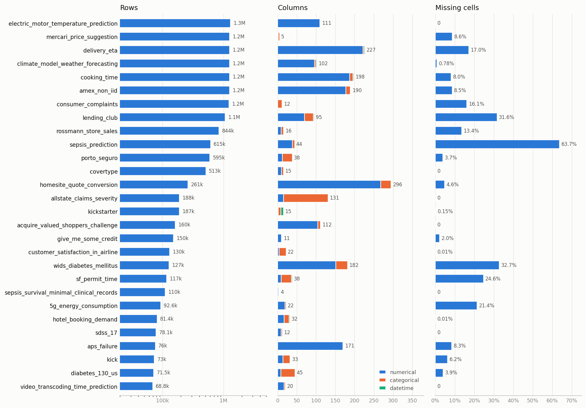

# TabGenBench

Tabular generative models are reaching performance saturation on simple datasets like `adult`, making it difficult to distinguish between models. TabGenBench is a new benchmark for tabular data generation, curated from
[BeyondArena](https://huggingface.co/datasets/TabArena/BeyondArena). It contains 28 challenging real-world datasets from diverse domains, including finance, healthcare, manufacturing, and scientific research. The datasets are selected to provide sufficient training samples for learning meaningful feature distributions and dependencies.

This package provides scripts for downloading datasets, preparing and validating the benchmark, generating reproducible and ready-to-use train/validation/test splits, and evaluating downstream tasks. TabGenBench contains

- **28 real-world tables**: repurposed for IID tabular data generation (original tasks: 15 binary classification, 3 multiclass, 10 regression)
- **Data size**: 69,000 to 1.3 million rows and 4 to 296 columns per table before preparation; 15 million rows in total
- **Data split**: 80 / 10 / 10 ratio for train / validation / test split
- **Missingness**: over 70% tables contain missing values; missing rate reaches as high as 63.7%
- **Downstream tasks**: prediction and imputation tasks for evaluating conditional generation capability



## Install

```bash
pip install .            # from a clone of this repository
```

Requirements are specified in `pyproject.toml`.

## Quick start

```python
import tabgen_bench as tgb

tgb.list_tables()                    # the 28 table names

splits = tgb.load_table("kick")      # {"train": df, "validation": df, "test": df}
train = splits["train"]
val = split["validation"]
test = split["test"]
spec = tgb.load_spec("kick")         # columns, kinds, target, task

tgb.prepare_tables()                 # prepare all 28 tables: 4.8 GB download, about 25 minutes
```

The same preparation steps from a shell:

```bash
tabgen-bench download        # 4.8 GB
tabgen-bench prepare         # 4.4 GB, about 25 minutes for all tables
```

The benchmark data is stored in the directory specified by the `TABGEN_BENCH_DATA` environment variable, if set, or in `~/.cache/tabgen_bench` by default. Users can also override the data root using the `data_root=` argument in any function or the `--data-root` option in any CLI command.

## Downstream prediction and imputation tasks

Downstream tasks return observed inputs and target values in the prepared test split:

```python
tgb.list_downstream_tasks("kick")
# ('prediction', 'imputation_30', 'imputation_50')
task = tgb.load_downstream_task("kick", "imputation_50")
observed = task["observed"]
targets = task["targets"]
```
Three reproducible and ready-to-use downstream tasks are available. `prediction` returns original prediction task associated to a dataset; `imputation_30` returns imputation tasks with 30% columns are randomly masked per row; likewise, `imputation_50` randomly masks 50% columns per row.
Masks indicating hidden values are automatically downloaded from `Granica/TabGenBench` on [HuggingFace](https://huggingface.co/datasets/Granica/TabGenBench) upon first use.


## Licences

Each table remains under the licence of its original source. License information is stored in each dataset's `tabgen_bench/table_sources/<table-name>/dataset.json`.


## Citation

If you use TabGenBench in your research, please cite our repository:

```bibtex
@software{tabgenbench2026,
  author = {Granica Research Team},
  title = {{TabGenBench}: Benchmarking Tabular Generative Models at Scale},
  year = {2026},
  url = {https://github.com/granica-ai/tabgen-bench},
  note = {GitHub repository}
}
```

A technical report describing TabGenBench is forthcoming.
